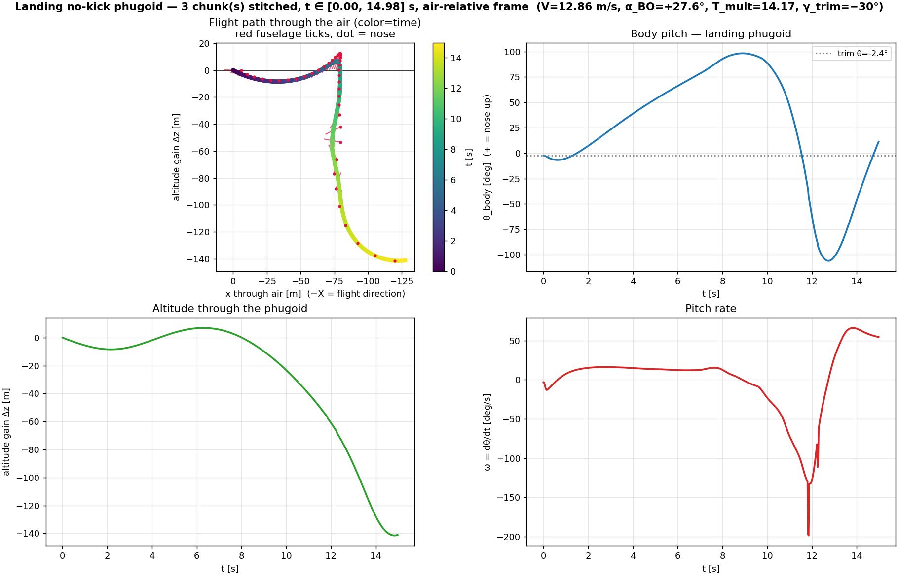
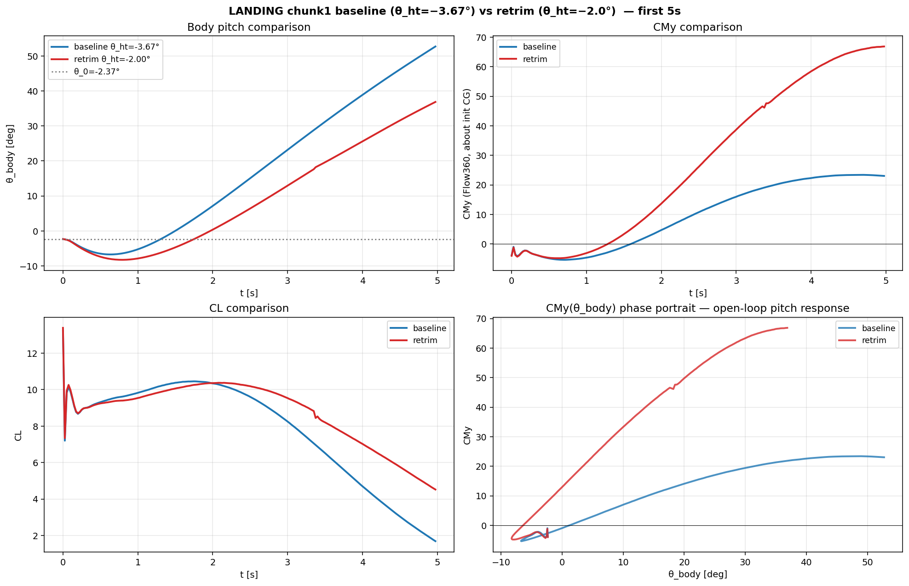

# Open-loop landing dynamics — characterization run

**Status (2026-05-29):** open-loop dynamics from the landing trim
characterized.  Trim is statically unstable; without active control the
airframe departs trim, executes a half pitch-up loop, and goes deep upset.
This is the precondition for the landing-maneuver controller (Task #84).

## Trim point under test (PHASE_TRIM["landing"])

|             |                          |
|-------------|--------------------------|
| V_inf       | 12.86 m/s (25 kt)        |
| V_init      | 12.86 m/s (same — no wind-tunnel drift) |
| altitude    | 0 m (SL, ISA)            |
| α_BO        | +27.6°                   |
| θ_ht        | −3.67°                   |
| T_mult      | 14.17  (T/W ≈ 0.67, blown-lift) |
| γ_trim      | −30° (steep approach)    |
| θ_body @ t=0 | α_BO + γ_trim = **−2.4°** (nose slightly down — what a steeply descending airplane actually looks like in world frame; α at the wing = α_BO = +27.6°) |

## Run setup

* Geometry: `tsangpo_v3.csm` phase=2 (gapped flap, landing flap angle).
* 4-cyl Tsangpo phugoid mesh (`gap110`).
* Warmup: 30 physical × dt=1.0 s × max_pseudo=1500.
  Settled coefficients: CL=3.717, CD=2.259, CMy=+1.241 (about initial CG).
  Note: in flat-freestream wind-tunnel BC with stationary walls, the warmup
  sees α=θ_body=−2.4° — the post-stall *negative* side, NOT the design α
  of +27.6°.  Hence the modest warmup CL.  See "Caveat" below.
* Chunks: dt=0.025 s × 200 steps each (5 s/chunk) × max_pseudo=200.
* γ_kick = 0 (no-kick test — relying on the trim residual as the
  perturbation source).
* Symplectic Euler–Cromer integrator (commit 9c2a835), γ_trim init
  fix (commit 5a98590).

## Result — chunks 1-2 (clean 10 s window)

* **θ_body trajectory:** −2.4° → −6.5° (brief nose-down from wall-BC
  transient at chunk1 start) → 0° at t=1.5 s → **+98° at t=9.0 s (half-loop apex)** → starts returning.
* **CL trajectory:** ~8 → ~10 (post-transient settle) → collapse to ~0 at
  t=6 s as the wing enters deep stall past θ≈+30°.
* **CD trajectory:** 2 → 7 spike near θ=+30° (stalled wing, broadside to
  flow) → drops to ≈0 past θ=+90° (wing tumbled out of the flow direction).
* **CMy(θ_body) curve** is the diagnostic:
  - **Positive ∂CMy/∂θ in θ ∈ [−5°, +30°]** → trim is *statically
    unstable* in the operating range.
  - Peaks at CMy ≈ +24 at θ ≈ +30° (just past stall).
  - **Negative slope past +30°**, but CMy stays positive (and large) all
    the way to θ≈+95° → the moment is still driving nose-up.
  - CMy crosses zero at **t ≈ 9.49 s** ⇒ q̇ flips negative; body starts
    pitching back down.
* **CG drift in chunk1+2:** +46 m in world-x (drifting forward), −20 m
  in world-z (descended 20 m).  Consistent with γ_trim = −30° descent
  plus the half-loop's vertical excursion.

## Chunk3 — numerical limit reached

Chunk3 was the first to enter the post-peak return phase at extreme
pitch rates (q magnitude up to >20 rad/s = 1100°/s by chunk2 end).  At
that level the dynamics outran the solver fidelity at our settings:

* CMy oscillated wildly between −316 and **+625** over t=12–13 s.
* Eventually CMy reached **−2844** at t=14.9 s with CL=33 (vs chunk1
  peak ~+24 / ~10).
* CD went strongly negative (−16 at t=13.4 s, then bounced to +12) —
  unphysical for an airfoil with attached flow; only meaningful in
  upset.
* Inner-pseudo at 199/200 cap on essentially every step ⇒ converged
  pseudo-iter exhausted at the high physical-step CFL.

This is past the validity of the symplectic UDD + dt=0.025 s + 200
pseudo-cap combination.  Chain auto-fork was disabled at chunk3
(chunks 4-6 removed from `run_landing_phugoid_chain.py`) rather than
burning credit on unphysical extrapolations.

## Interpretation

The high-α blown-lift landing-trim is a knife-edge: lift is high but
∂CMy/∂α is positive in the operating range (a classical post-stall
divergence signature with the htail's authority unable to overcome
the wing+flap pitching moment without slipstream + active stabilization).
The 30 s no-kick run shows there's no natural recovery — the airframe
departs trim, climbs through stall, executes a half pitch-up loop, and
goes upset.

**This is the test case the landing-maneuver controller (Task #84)
must stabilize.**  The clean 10 s open-loop trajectory is what to
benchmark the closed-loop controller against — with the right control
inputs (θ_ht, T_mult modulation) the airframe should hold trim
indefinitely.

## Retrim experiment (θ_ht = −2.0°) — 2026-05-29

Tested the hypothesis "small CMy residual from θ_ht trim mismatch on
4-cyl mesh drives the divergence."  Submitted a fresh warmup with
θ_ht moved from −3.67° (baseline) to −2.0° (less LE-down).  Result:

| trim       | θ_ht  | CMy_converged |
|------------|-------|---------------|
| baseline   | −3.67°| +1.241        |
| retrim     | −2.00°| +1.011        |
| Δ          | +1.67°| **−0.230**    |

⇒ **ΔCMy/Δθ_ht ≈ −0.14 per degree of θ_ht.** Zeroing out the +1.241
residual via htail trim alone would need θ_ht ≈ +5.3° (way outside any
realistic flight setting, and well past where downwash+htail-α-response
would stay linear).

The htail has *very little authority* over the warmup CMy because the
warmup pose puts the wing+flap at α=−2.4° (post-stall negative regime),
not the design α=+27.6°.  That ~30° mismatch in aerodynamic state is
the *actual* dominant issue; θ_ht only nudges it.  The +1.24 residual
isn't a tuning bug — it's a structural consequence of running the
warmup at the wrong α.

### Retrim chunk1 (θ_ht=−2° phugoid) — actual trajectory

Forked a no-kick phugoid from the θ_ht=−2.0° warmup
(case-484c926a in prj-fe988f58) to see what the trajectory looks like.

At t=5 s:

|                  | baseline (θ_ht=−3.67°) | retrim (θ_ht=−2.0°) |
|------------------|------------------------|---------------------|
| θ_body           | **+52.7°**             | **+36.9°**          |
| CMy (CSV)        | +23                    | +67                 |
| CL               | +1.7                   | +4.5                |

**Retrim's body rotates ~30% slower** despite a larger CSV CMy.  The
CSV CMy is computed about the fixed initial-CG reference; the
integrator's effective M is about the *current* CG and includes a
lever-arm correction that depends on body translation — so CSV CMy
overstates the effective moment in the retrim case where the body
moves more.

The CMy(θ_body) phase portrait reveals the underlying picture: both
curves cross CMy=0 at θ_body ≈ 0° — that's the *natural* trim of the
open-loop airframe in this regime.  Our prescribed trim
(θ_body_trim = α_BO + γ_trim = −2.4°) sits *below* the natural trim,
so both runs depart upward to find their own equilibrium and overshoot.
The retrim's steeper ∂CMy/∂θ slope means the natural-trim equilibrium
is more *unstable* (steeper positive slope through zero), but the
overshoot dynamics are different in detail.

**Bottom line**: retrim helps modestly (~30% slower divergence) but
doesn't stabilize.  The intrinsic instability of the high-α
blown-lift landing trim isn't a θ_ht tuning bug — it's a property of
the underlying CMy(θ) curve in this regime.  The controller must
provide the missing stabilization.

### Proper fix — put the warmup at the right α

Two options, both one-line changes:

(A) **Tilt the body, keep the freestream flat** (the canonical CFD
    convention).  Set `theta_body_trim = alpha_BO_rad` (drop the
    `+ gamma_trim_rad` term from line 813 of unsteady_setup.py).
    Body sits at θ_body = +27.6°, walls stationary, freestream along
    +X ⇒ α = +27.6° matches the steady campaign.  Phugoid chunk1
    still applies γ_trim to the body's *velocity vector* (the Vz_0
    initial condition), so the descent is properly encoded.

(B) **Tilt the freestream, keep the body horizontal-ish** (the
    "wind-tunnel that tests descent" approach).  Set
    `AerospaceCondition(alpha = gamma_trim_rad)` (=−30° for landing).
    Freestream comes from above-and-forward; body at θ_body=−2.4° in
    world sees α=+27.6° relative to the tilted freestream.

(A) is simpler and matches the steady CFD campaign's convention.  Either
would eliminate the chunk1 wall-BC transient AND give a warmup whose
CMy residual reflects actual trim quality, not pose-mismatch.

The warmup converges with the walls held stationary in flat freestream
⇒ the body sees α=θ_body=−2.4°, NOT the design α=+27.6° (which requires
the body to be descending at γ=−30° so its apparent wind comes from
above its nose-axis).  When chunk1 forks with non-zero initial velocity
encoding the descent (Vx=+1.72 m/s, Vz=−6.43 m/s), the wall BC at the
body suddenly demands α=+27.6° flow.  The flow re-equilibrates over
the first ~0.5 s of chunk1 — this is the spike in CL at t=0 (CL=13.94
at step 30) that drops to 5.5 at the next step.  After the
re-equilibration the dynamics evolve smoothly through the half-loop.

A cleaner experiment would either (a) tilt the freestream by γ_trim
(`AerospaceCondition.alpha = γ_trim`) so the warmup walls correspond
to the design α at stationary body, or (b) drive the warmup with
UDD-active cylinders already moving at the trim velocity.  Both are
single-line changes to investigate later; the chunk1+ dynamics past
t=0.5 s are not contaminated by this transient (the body is in the
right α regime by then, and the half-loop signature plays out cleanly).

## Files

* `nokick_landing_trajectory.png` — 4-panel stitched plot.
* `nokick_landing_attitude.mp4` — attitude animation.
* `chunk1_full_5s.png` — chunk1 detail with CMy(θ) phase portrait.
* `chunk1_oscillations.png`, `chunk1_oscillations_v2.png`,
  `chunk1_progress.png` — diagnostic plots used during the run.

## Case IDs

| | case ID | status |
|---|---|---|
| landing warmup | `case-3c096a1e-ebad-4d72-950e-420c10500182` | completed |
| chunk1 (no-kick, diag) | `case-5737a885-f9b4-46c1-9c36-be44570471b3` | completed |
| chunk2 (no-kick) | `case-c5c327fe-1a36-46cd-8a7d-3fcb42880bd0` | completed |
| chunk3 (no-kick) | `case-d2933c05-67d9-4e51-9445-566335f24cce` | completed (last 2 s numerically diverged) |
| chunks 4-6 | — | not submitted; chain stopped at chunk3 |

Project: `prj-7d4c5536-26ad-42cf-a75a-1cd5cb5e6ce8`
(Tsangpo / 6_v3_short_boom / `tsangpo_v3_unsteady_warmup_landing_gap110`)
